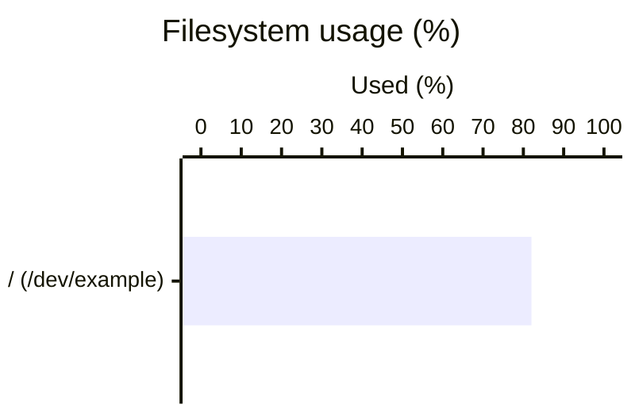

# Bundled host vault content application

Vault is the bundled content application over [recipe retention](retention.md). Structured retention remains authoritative; generated Markdown and human notes live in `vault/`. The platform owns paths and publication, while the bundled author chooses readable views. Other reviewed content applications can consume the same data without Vault.

## Identity and configuration

Open `<profile-root>/vault/` in Obsidian or another Markdown reader. Reading tables requires no model, connection or plugin. The generated `mermaid` fences use Obsidian’s [built-in Mermaid support](https://obsidian.md/help/advanced-syntax#Diagram). No Diagrammo plugin or MCP server is required. Other readers need Mermaid support, including XY charts; tables remain available when diagrams are unsupported. `feast.yaml` accepts `vault: {auto_refresh: false}` to disable automatic publication; it does not disable retention or change recipe selection.

Host identity is namespace plus host ID. Primary group affects content routing, not identity or the independent annual SQLite archives. See [retention storage](retention.md#storage-and-execution-phases).

## Automatic Obsidian reader setup

For the Obsidian reading workflow, install the application separately; OpsFeast configures Vault assets without launching or installing it. Other Markdown readers can use the tables and their own Mermaid support. Structured retention/CLI operations retain their existing dependencies.

The default enabled Vault consumer during initialization, subsequent full consumer rebuilds, and explicit `vault rebuild` prepare these profile-local files:

- `vault/.obsidian/snippets/opsfeast-mermaid-fit.css`: managed copy of the public `templates/vault/opsfeast-mermaid-fit.css` asset; it fits diagrams to the prose width and styles external captions/spacing.
- `vault/.obsidian/appearance.json`: on first adoption, add `opsfeast-mermaid-fit` to `enabledCssSnippets`, preserving all other keys and entries. Later rebuilds respect removal from that list, including deliberate disabling, while still repairing/updating the managed CSS.
- `vault/.reader-assets.json`: dedicated CSS ownership/digest map, separate from Markdown ownership manifests. An edited owned copy can be replaced; put personal overrides in another snippet. An identical existing CSS copy can be adopted. A different unmanaged file at the reserved name causes a content failure rather than being overwritten.

Invalid JSON, non-object appearance settings, a non-string-list `enabledCssSnippets`, malformed ownership metadata and symlink paths fail publication. Preflight runs before reader writes and generated page publication; files are replaced atomically one at a time, not as a whole Vault transaction. A first setup interrupted between asset/settings/manifest writes can be retried through full rebuild. Preserve the reported content failure separately from successfully retained data.

`vault inspect` and `vault groups` do not install or activate reader assets. Disabling automatic Vault publication prevents that publication path; explicit full rebuild still prepares reader assets. If the Vault is already open in Obsidian, reopen it to load newly written reader settings; filesystem preparation does not prove that a running reader has loaded them. User-created Vaults, including a first opening of the textbook folder, need an agent-assisted copy/enable step using the supplied asset and existing settings. No community-plugin installation, model, host connection or new collection is involved.

Public reader-setup tests cover settings preservation/opt-out, collisions, invalid input, symlink rejection, interrupted retry, initialization, asset packaging and exclusion of local reader settings. See [the reproducible tests and review evidence](../tests/README.md#vault-reader-and-storage-review). File preparation does not assert live reload in an already-running Obsidian instance.

## Enable or migrate

```sh
python -B tools/opsfeast.py init main --namespace production --json
python -B tools/opsfeast.py vault rebuild --profile main --json
python -B tools/opsfeast.py vault groups --profile main --json
python -B tools/opsfeast.py vault inspect --profile main --json
```

All commands also accept `--root PATH` instead of `--profile`. Init preserves an existing namespace/configuration. Rebuild refreshes generated pages and group links without collecting or writing retention/run data; groups refreshes membership links only; inspect is read-only. Exit codes are 0 success, 1 failure, 2 argument error. The old SQLite-in-vault layout is incompatible and is never moved/deleted automatically: preserve the old profile and use a separate initialized profile plus reviewed [raw replay](retention-replay.md). Rebuild cannot reconstruct missing old collection values/evidence.

Automatic publication uses the [Vault consumer](../consumers/vault/README.md), default registration `builtin:vault`. Observation creation/deletion, operation creation and `retention.run.updated` events queue current-state updates. The bundled batch consumer rebuilds once per
nonempty dispatch snapshot and records each event separately; skipped-host events
do not each cause a rebuild. The completed-collection and command-outcome dispatches
remain separate. Failed/running deliveries retry without deleting event history. Use `consumers inspect` and `consumers dispatch vault` for failed deliveries. Explicit `vault rebuild` does not create or acknowledge events.

## Directory and ownership

```text
vault/
  README.md                         # preserved human landing page
  HOSTS.md                          # generated host and Observations navigation
  .content-structure.json
  .content-bundled-retention.json
  .content-groups.json
  Observations/
    SUMMARY.md                      # explicit execution-batch index
    YYYYMMDDHHMMSS.md                # UTC batch start, collisions use -2, -3...
  hosts/<encoded-primary-group>/<encoded-host-id>/
    SUMMARY.md                      # generated host entrypoint
    README.md                       # preserved human notes
    records/SUMMARY.md               # generated host record index
    records/current-<title>.md       # readable current state
    <UTC-year>/reports/<YYYYMMDDHHMMSS>-<title>.md
    <UTC-year>/operations/<precise-UTC-time>-<title>--<record-hash12>.md
  overview/README.md
  groups/README.md
  groups/<encoded-group-id>/README.md
  groups/<encoded-group-id>/<encoded-host-id>.md
```

The consumer title is independent of recipe path; inventory uses System inventory. Historical observation report names contain a whole-second UTC time and title, with no UUID, fractional seconds or hash suffix. Same-second/title collisions get `-2`, `-3`, etc.; a shared mapping drives generated report paths and source links. Operation journals retain precise time and intent/result discriminators. Independent current datasets that resolve to the same title still fail publication rather than overwrite one another. Names are safe and bounded; full IDs/references remain in report metadata.

Primary group is the first resolved membership; secondary groups link to that one host tree. Ungrouped/archived hosts use `_ungrouped`; a real group with that name is encoded distinctly. Full rebuild routes all generated history/current pages and indexes to the current primary group and removes stale owned pages. Human README files and unmanaged notes stay at their original paths; relocate/link them deliberately. `groups` alone does not relocate host content.

`records/SUMMARY.md` replaces the generated records/README index. It is a navigation page for current records and operation history, not an additional observation or human notebook. Generated host/SUMMARY.md links to records/SUMMARY.md and human README notes; HOSTS.md and group navigation target host/SUMMARY.md. Missing host README stubs point to this host summary. Existing human README pages are preserved and may need their own link updates. Generated old names are removed only when manifest-owned; manual links are not migrated or aliased.

Manifests track separate structure, bundled-content and group owners. Ownership authorizes replacing generated output even after editor/manual changes and removing stale owned paths. Removing the notice does not remove ownership. Unmanaged paths and other owners' files remain protected; collisions fail explicitly. Publication is atomic per file, not for the whole Vault; inspect an interrupted generation before retrying. Never store human notes inside owned pages.

Checkout authors may call `host_vault.publish(root, owner, entries)` while holding `host_vault.locked(root)`. owner is a stable lowercase identifier and entries maps safe relative `.md` paths to bodies. The publisher adds the generated notice and local-second modification footer. Arbitrary binary publication is outside this interface; link validated report artifacts instead. This is a checkout service, not a stable Core API.

## Recipe retention and Markdown

Recipe authors own data definitions/extraction; content authors own presentation. There is no `retention.markdown_template`. `vault_content.build(root, runtime)` reads retained records and explicit runs, returning bodies/index/host IDs without writes or connections. `host_vault` publishes them; consumers/vault/main.py supplies event dispatch. Never scrape Markdown as the data interface: use `profile.retention.query/show` and `runs/run`.

### Current records: readability

Current inventory pages start with the configured host icon/name and Observed time. Empty Attention is omitted; flagged Attention appears before Contents. Content is grouped by subject: System, Hardware, CPU and memory, Network, Storage, Software and Services. There is no static/dynamic split. Network configuration and measured network state stay together, as do other topic-related values.

Current views omit null/empty-string fields and sections with no readable data. Zero, false and explicitly observed empty collections remain distinct; the latter says No entries reported. Missing/failed/latest coverage is still signaled and linked to the full report; an omitted value is not a successful absence check. Package and service collections are shown completely, sorted by name. Other long collections can use a 12-row preview and source-report link. Table units are incorporated into values instead of a redundant Unit column; duplicate Sample time columns are removed while section/sample provenance remains in reports/structured data. Matching byte/MB filesystem projections are deduplicated only when entity, source/time and converted value agree. Filesystem layout and capacity remain distinct tables.

Single cumulative I/O counters do not establish rates and are omitted from current views; measured-window CPU utilization remains. The renderer does not invent throughput or link topology. Data/coverage and identity warnings remain visible. A single top source-report link is used when all displayed sections share it; mixed-age sections link their own source reports when different. Current pages omit the full Collection metadata disclosure, which belongs in reports.

Mermaid definitions add reported filesystem-usage bars (`xychart-beta horizontal`) and host/interface/address grouping (`flowchart LR`). Example text generated from observed values:




XY charts use a 400-unit logical width, a row-dependent height and the bundled CSS gutter so narrow readers do not clip axis labels/ticks. Long filesystem labels use unique FS numbers with an adjacent table of complete reported labels; percentages and source data are unchanged. Only valid reported percentages in 0–100 are plotted; absent percentages are not calculated or treated as zero. Interface graphs show grouping/addresses, not physical links or inferred operational health. Node IDs are generated independently of labels. Labels collapse whitespace, remove control characters and replace markup/directive delimiters with display characters to prevent fence/line/diagram injection; original spelling remains in tables and reports. Diagram support introduces no collection or network dependency.

Existing generated DGMO fences change to Mermaid when owned pages are next published or explicitly rebuilt with `vault rebuild`. No retention conversion or new collection is needed. Human-authored diagrams and unmanaged notes remain user-owned; rebuilding cannot convert those.

### Original command output

Current inventory records append a Command output section. Each recorded command has a default-closed HTML details block; command, stdout and stderr use escaped pre/code elements so spacing and literal output remain readable. Source observation, sample time, state and exit code identify the actual evidence. Empty streams say (empty); unavailable or historical unrecorded streams say Not recorded. Truncation is explicit. The display does not redact or summarize recorded text.

A mixed-age current view includes probes from the exact retained records supplying its latest property attempts, including CPU measurement dependencies. A shared probe appears once per source record; repeated commands from different observations remain separate. Rebuild reads retention only, never reconnects, reads raw files to fill missing output or fabricates old stdout. The [inventory stream contract](inventory-jobs.md#source-times-histories-and-latest-views) defines capture bounds and evidence limits. Other recipe contracts do not automatically gain this behavior. Tables and charts remain available above the output section; full structured probe evidence remains accessible through retention APIs.

### Reports: complete evidence

Yearly reports prioritize completeness over compact display. Job reports retain every sample's property, entity, value, unit, state, sample time and source; full observations and collection metadata remain available, including null/unavailable values. Null, false, zero and empty collections are not interchangeable. Original precision is retained in structured data even when Markdown uses human units or local-second time display. Current-view omission/preview/deduplication does not remove stored or full-report data.

Historical reports have one final Collection metadata section with source/reference/version, record/origin/retention provenance, actor/identity scope and recorded coverage/queries. Detailed provenance can use HTML disclosure; readers without it may show expanded content. Commands/states/reasons come only from recorded collection evidence or job probes. Legacy reports lacking evidence explicitly say Not recorded; rebuilding does not read raw results, guess the collector or recollect data. A successful base observation does not establish full extended coverage. Identity quality, partial/unknown states and failure reasons remain interpretation context.

### Latest selection and source times

Current datasets are grouped per host by origin namespace, recipe-source qualifier and stable recipe ID, then the newest whole record is selected with record ID breaking equal-time ties. Recipe moves within that source do not rewrite historical references or create aliases. Independent sources/origins remain separate; title collisions are errors.

For inventory-job-observations, current pages combine the latest attempt per property/entity, with original group/sample source times. Failed latest attempts stay gaps; they never fall back to older successes. Attention can compare different-age baseline/metric observations and identifies their times. Other contracts retain their own whole-observation semantics. The host index reports observation state/time, not online status or live health.

Contents links use native Obsidian heading fragments with preserved case and URL-encoded spaces/non-ASCII text. Repeated headings get distinct readable names. In Reading view follow the link normally; Live Preview uses the reader's follow-link gesture. Heading conventions in other readers can differ.

## Observation batches and Attention

[Execution runs](observation-runs.md) produce `Observations/SUMMARY.md` and timestamp-named batch pages. The index shows the recorded command success/failure and original Targets selectors. Per-run metadata precedes Contents and includes duration in whole seconds. Hosts tables contain Host (linked directly to its source report), Status and Collection jobs; storage/publication failures appear as warnings, without redundant Retention or Source report columns. Unrecorded historical selectors/outcomes remain Not recorded. Attention contains flagged hosts only. This directory is distinct from profile-root `observations/` raw JSON. Old nearby records are not fabricated into historical runs.

Current inventory Attention uses the current resolved `recipes.REFERENCE.vars.attention` policy; a local rebuild applies changed thresholds without recollection. Batch pages display the saved policy/findings for that execution and do not reevaluate history using current settings/new samples. Disabling recipe execution preserves retained data/current pages; disabling `attention.enabled` suppresses current threshold evaluation independently. See [threshold definitions and limits](inventory-jobs.md#attention-thresholds).

## Long-lived operation journal

Write/unknown operation evidence belongs to retention. Vault renders intent/outcome links, preserving unresolved and unknown verification states; successful command results do not prove a verified change. Content failure never erases the journal. See [operation interfaces](retention.md#operation-journals-and-module-boundaries).

## Checkout module interfaces

Use `host_vault.rebuild/refresh_groups/publish` and Vault CLI for content. Use Core `profile.retention.query/show/runs/run`, checkout `retention_store.query/show`, `observation_runs.list_runs/show`, and the retention CLI for data. Read [run producer interfaces](observation-runs.md#checkout-interfaces-and-verification) before composing a batch writer. Do not edit annual SQLite tables or instantiate a second configuration/normalization pipeline.

## Consistency and verification limits

Public synthetic tests cover current-view omission versus full reports, sorting, units, filesystem deduplication, I/O suppression, diagram-label safety, thresholds, batch snapshots, links, collisions, publication ownership, retention/replay and independent failure receipts. See [review evidence](../tests/README.md#vault-reader-and-storage-review) for interpreter, package and standalone Mermaid rendering checks. Standalone rendering does not establish compatibility with every Obsidian or Markdown-reader version. No new native SSH/privilege-policy evidence, hosting, transmission, whole-vault transaction or cryptographic authenticity claim is added.

## Database replication content

The existing builtin:vault consumer renders registered mysql-replication 0.1.0 observations from [the MySQL/MariaDB recipe](../recipes/database/mysql/check/replication/README.md). Under the normal host location, `records/current-mysql-replication.md` shows every instance/channel with database identity, source, lag, health and credential-cleanup uncertainty. `YEAR/reports/TIMESTAMP-mysql-replication.md` preserves all sanitized retained details, including filters, coordinates/GTIDs and fixed-query evidence. Current views link their source report. No database connection or policy reevaluation occurs during rebuild; ordinary ownership/activation and separate delivery receipts apply. Raw error text and credentials are intentionally absent rather than reconstructed from raw reports.

## Replication status must be visible first

MySQL/MariaDB current records show observed time, then a Replication status section
before Contents. Large HEALTHY/UNHEALTHY/UNKNOWN/NOT CONFIGURED (or mixed NEEDS
ATTENTION) labels combine symbols and words; native Obsidian success/danger/warning
callouts add color without making color the sole signal. Instance summaries remain
separate, so a healthy instance cannot hide another unhealthy or unknown one.

Instance details and each channel use two-column vertical tables instead of a
semicolon-dense paragraph or a wide seven-column channel table. Unhealthy instance/
channel findings get explicit danger callouts with explanations and original saved
reason codes. Missing delay/source/thread evidence says Not reported; zero seconds
remains an observed zero. Cleanup uncertainty and a partial record with only healthy
instances cannot produce a healthy overall banner. Unhealthy takes precedence when
it is observed alongside unknowns; counts still disclose both states.

This summarizes saved health labels/cleanup/collection state, without rerunning SQL,
recalculating thresholds, verifying source catch-up or claiming live health. An
unhealthy but fully collected result is not automatically described as missing data.
Historical reports retain full sanitized evidence after the readable sections.
Callout-unaware Markdown readers still show explicit status text and tables. Rebuild
uses retained data only, preserves raw/retention and unmanaged human notes, and
updates owned generated views through the existing publisher; no CSS/plugin or
application-wide font setting is required.


## Backup checks and service objects

`backup-files-check` 0.1.0 renders current daily presence, saved policy/zone/deadline, scan completeness, expected paths and short expired/unexpected-entry previews. Full historical reports preserve complete retained lists. Partial counts are lower bounds; absent fields are not healthy empty lists. Interpretation uses saved thresholds/findings, without rescanning or reevaluating historical age. See [backup contract and verification](backup-file-checks.md).

The independent default service presentation owns `Services/SUMMARY.md`, `Services/notification/<uuid>.md` and `Services/todo/<uuid>.md` using owner `service-vault`. It shows lifecycle/revision/source/history and links to an existing owned historical report when available; missing evidence stays explicit. It does not create or mutate conditions. Edit objects through [service API/CLI](services.md), then dispatch projections. Keep human files outside generated ownership, or use todo note fields. Multiple [service presentation adapters](service-adapters.md) may coexist with independent receipts; disabling vault.auto_refresh suppresses automatic builtin service presentation too.


## Imported and archived evidence

Data import uses the protected portable-data owner for Transfers/SUMMARY.md and per-unit previews (12000 characters). Full payload/schema/attachments remain available through transfer show/API without producer code. This view does not duplicate all local raw evidence or convert a transferred batch snapshot into a new local execution. transfer rebuild repairs these pages without consumer/provider execution.

Archive repairs bundled owned views and compacts active storage while preserving human files and independent notification/todo objects. Service evidence can identify the verified archive package/receipt when its active report was removed. Custom adapters/consumers are not invoked by archive; their stale copies require separately authorized maintenance. Read [complete storage/recovery rules](portability.md).


## Assessment and execution-account evidence

Vault presents saved recipe assessment and execution-account evidence separately from fixed operation status. A custom label cannot suppress platform failures, and historical content does not recompute live findings. See [results and accounts](recipe-results-and-accounts.md).

## Physical disks and RAID views

[disks-raid 0.4.0](../recipes/system/storage/inventory/disks-raid/README.md) leads with independent physical and RAID counts/health. Physical purpose groups are Data, Boot and Unknown; per-tray tables show use, source state, capacity and health. Spare/Ready/unconfigured/Non-RAID drives remain counted and visible even when no RAID references them. A physical group has no virtual membership or RAID health field. Multiple controllers can share one data expectation; observed IDs only disambiguate source trays.

The independent RAID table preserves controller/volume names, health, level and capacity, with its own expected count. A failed RAID query does not erase known physical disks or their reported health. Unknown role classification can prevent the role baseline comparison while a complete physical total remains known. A Ready spare may be healthy without being Online. Controller, MD, boot mirror and source errors remain separate findings. Source details use narrow per-device tables and collapsed commands. Historical scope/assessment stays historical; current policy does not reinterpret old observations.

*Last modified: 2026-10-30 11:57:14*
