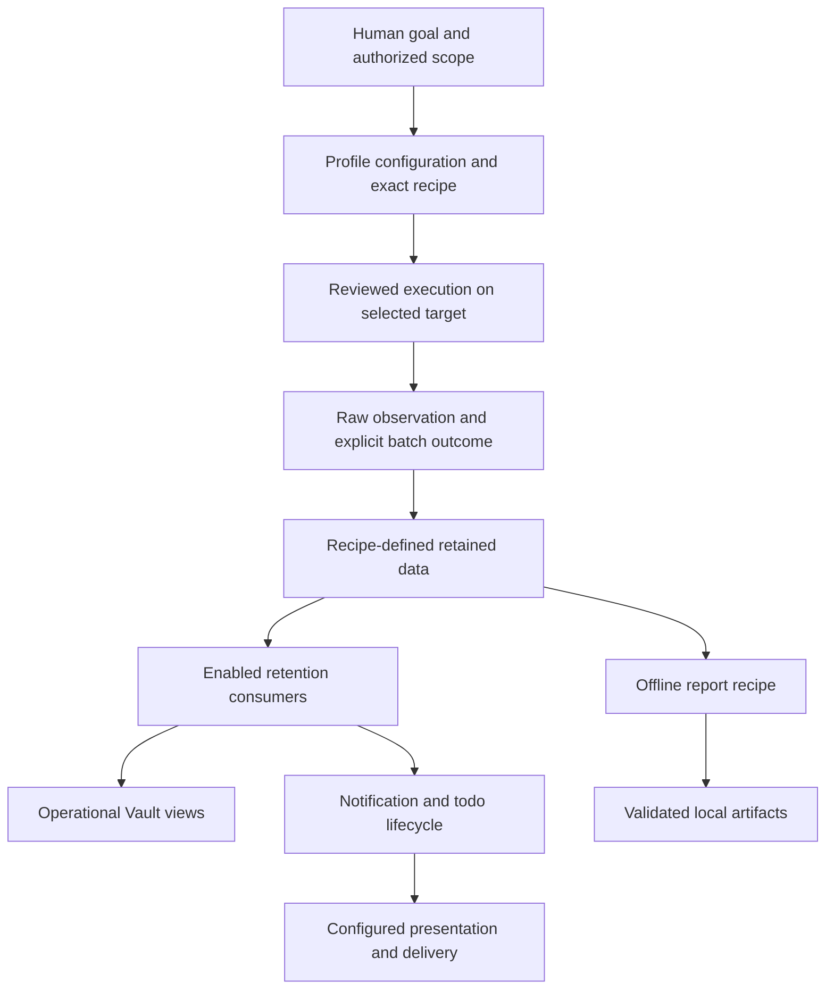

# 2. Architecture and the data journey

[Book home](README.md) · Previous: [Intent](01-intent-and-agents.md) · Next: [Setup](03-setup-and-profiles.md)

The easiest way to understand OpsFeast is to follow one operation from a selected environment to reusable evidence. The installation supplies tools and bundled knowledge. Each profile points to a management root containing private configuration, operational data and content.

## The core objects

| Object | Purpose | Common misunderstanding |
| --- | --- | --- |
| Instance | The installation identity, with UUID, name and optional description | A copied checkout is automatically the same legitimate installation |
| Profile | A registered name selecting a management directory | The name must match a directory under `feasts/` |
| Namespace and host ID | Scope the logical host's continuing history | An address or observed hardware UUID alone defines history |
| Recipe | Versioned reviewed operational or report code with declared inputs and outputs | A recipe ID is always an unambiguous executable path |
| Observation | Saved evidence of an execution or measurement, with original source identity/time | Every execution necessarily produced retained data |
| Observation run | Explicit membership and outcomes of an operational batch | Nearby timestamps prove that old observations belong to one batch |
| Retention | Structured, discoverable datasets and durable operation evidence | Generated Markdown is the authoritative database |
| Consumer | Reviewed event-driven program consuming retained data | Installing a recipe automatically activates every attached consumer |
| Vault | Bundled readable views plus separate human notes | Regenerating a page recollects current host facts |
| Services | Notification/todo lifecycle, history and delivery state | A todo executes its work or a notification proves mail arrived |

## Follow the flow



If the reader does not render Mermaid, read the arrows as a sequence: configuration → execution → raw evidence → retained data → consumers → content and services. Offline reports read selected data to create artifacts. A failure later in this sequence does not necessarily undo earlier stored evidence.

For a backup check, SSH connects to the backup destination. A scanner reads metadata and returns dated-file findings. The recipe supplies structured data and an assessment. Retention stores that observation. An enabled backup policy consumer can reconcile incidents and hygiene todos. Vault presents the data, and configured adapters may publish or send service objects. Each stage has its own evidence and failure conditions.

## Know where things live

```text
opsfeast-checkout/
  tools/                    CLI entrypoints
  opsfeast/                 reusable Python modules
  recipes/                  bundled recipe sources
  consumers/                bundled consumers
  skills/                   complete agent guidance sources
  docs/                     canonical human/agent references
    textbook/               textbook language entrypoint
      en/                   English teaching vault
  .opsfeast.yaml            private profile registry
  feasts/main/              one possible registered management root
    hosts.yaml              private hosts, accounts, settings and sources
    feast.yaml              namespace, consumers and service configuration
    recipes/                optional profile-local recipes
    observations/           raw operational results
    retention/              authoritative retained history and projections
    vault/                  generated operational content and human notes
    reports/                offline report results and artifacts
    jobs/                   saved recipe invocations
    services/               notification/todo state and delivery history
    transfer/               imported data, transfer plans and recovery receipts
```

Optional directories appear when their feature is used. Profiles can point outside this checkout. Resolve the actual registered root before looking for data; never silently fall back to another profile when the chosen one is unavailable.

Inventory also uses profile-local `inventory.yaml`, `.inventory-state.json` and error records. These schedule settings differ from `hosts.yaml` recipe enablement and from saved recipe jobs.

## Separate identity, time and presentation

A stable logical host can survive a reinstall or address change. Observed hardware and account identifiers provide evidence, not automatic proof of physical continuity. Retain namespace, host ID, source instance/profile, recipe source and actual collection identity when combining data. Imported origins remain independent even when their host names match.

Observation time, per-property sample time, ingestion time and report-generation time describe different events. A freshly generated page can contain old or mixed-age samples. Rebuilding a view does not make them new. Missing values, zero, false and observed empty collections have different meanings.

**Checkpoint:** Locate the chosen profile's raw results, authoritative retained data, generated pages and human notes. Explain which stage you would repair if data exists but its page is missing.

Canonical guidance: [Core and instance identity](../../core-api.md), [profiles](../../profiles.md), [retention](../../retention.md), [observation runs](../../observation-runs.md), [Vault ownership](../../host-vault.md), and [services](../../services.md).

*Last modified: 2026-10-26 12:55:26*
