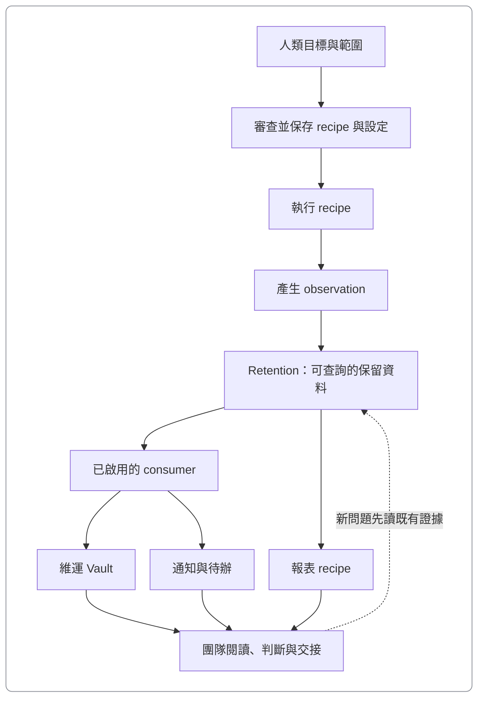

# 1. 認識 OpsFeast：讓維運成果持續發揮價值

[全書首頁](README.md) · 下一章：[建立本機環境](02-installation.md)

## 累積可重用的維運能力

OpsFeast 是一套協助伺服器維運團隊，在自己選擇的 AI agent 幫助下掌握系統狀態、累積並重用維運知識的工具。主要使用者是系統管理者，以及與維運工作相關的 PM（產品經理）和同事、職務代理人。它將主機與帳號設定、可重複執行的 recipe、執行證據、資料保存與易讀結果，放在同一套工作流程裡。

你可以先用自然語言描述目的，例如「盤點這台主機」或「檢查每天的備份有沒有到齊」。Agent 尋找適用的既有能力、準備設定與操作；你決定目標、權限與重要業務規則，並根據證據確認結果。例行工作交給保存的程式重跑，新的需求、判斷與例外再由 agent 協助。

## 自由選擇自己的 AI agent

你可以在 Codex、Antigravity，或其他具備必要操作能力的 AI agent 中使用 OpsFeast。OpsFeast 不要求選定某一家 agent 產品、模型或編輯器；共同基礎是可閱讀的文件與 skill、CLI、Python 介面，以及有定義的設定與資料契約。

操作條件與開始方式見[安裝章](02-installation.md#步驟-1開啟-ai-agent選定安裝目錄)。

## 讓日常準備化為即時應變能力

### 迅速完成 CVE 影響的盤點與分析

2026 年 10 月 21 日，PHP 發布處理 CVE-2026-109618、CVE-2026-109619 的重大安全更新。這類事件一出現，團隊首先要回答的是「哪些系統可能受影響、證據有多新、哪些應先處理」。公告日期與漏洞資訊可見 [PHP 官方安全公告](https://www.php.net/archive/2026.php)。

如果一次緊急盤點耗費 11 小時，下一個 CVE 出現時，難道又要重新投入同樣的工作？反覆登入、寫指令、整理表格與交接說明，不應每次從零開始。OpsFeast 要累積平時就能重跑的採集能力與可查詢證據，讓每次事件只補足新的判斷與資料缺口。

那天，**我們使用 `system/inventory/overview`，約 5 分鐘完成 30 台主機的盤點，並依結果找出高風險、應優先處理的主機。**已經準備好的主機設定與採集程式，讓我們很快把時間投入判讀與處理，而不用先為這次事件重新搭一套盤點工具。

我們希望讓這樣的準備成為日常：平時累積主機資料與可重跑的檢查，事件發生時先找出相關系統、排定優先序，再針對缺少的資訊補查。從盤點走到風險判讀的實際流程，放在[從 CVE 事件到可重用盤點](05-recipes-and-inventory.md#延伸閱讀從-cve-事件到可重用盤點)。

### 隨時準備，立刻應用

單一指令通常只解決眼前一步。當你管理多台機器、不同帳號與跳板時，還需要知道連到哪裡、用什麼權限、輸入哪些參數、結果是否完整、證據存在哪裡，以及同事如何重做同樣工作。

| 常見困難 | OpsFeast 提供的做法 |
| --- | --- |
| 每次都重新告訴 agent 主機、帳號與連線方式 | 在私人 `hosts.yaml` 保存主機設定與連線拓樸 |
| 同一件工作每次重寫程式 | 保存有版本、輸入定義與文件的 recipe |
| 結果只有終端畫面，過後找不到 | 保存 observation 與明確批次成員、狀態 |
| 不知道「執行成功」是否代表「沒有問題」 | 區分執行狀態、檢查發現與各階段回執 |
| 想看結果卻必須再連一次主機 | 從 retention 與維運 Vault 閱讀已存資料 |
| 同事想使用同一套做法 | 分享可攜 recipe，私人主機綁定各自設定 |

同一份資料也可以回答不同層次的問題：先檢查每天的 dump 是否到齊，再安排還原測試確認備份是否可用。每一步都有清楚的目的與可重用做法。

## 團隊協同

系統管理者處理連線、權限與維運操作；PM 關心影響哪些產品、處理優先序與進度；職務代理人需要迅速理解現況與接續工作。OpsFeast 的目標，是讓這個團隊以省力、節省不必要 Token 的方式共同達成管理目標。

| 角色 | 可以如何與自己的 agent 合作 |
| --- | --- |
| 系統管理者 | 準備主機設定、執行已審查 recipe、確認技術證據與修復驗證 |
| PM（產品經理） | 在獲准資料範圍內，探索哪些產品或環境需注意、要求來源清楚的報表；資料缺口再請維運補查 |
| 同事與職務代理人 | 閱讀既有 recipe、observation、retention 與人工背景，理解前次做法、結果和下一步 |

例如 PM 可以問：「依已保存的資料，整理本次事件中優先確認的系統、原因、來源時間與待補資料，產生一份我看得懂的報表。」這類工作可以先使用已有證據，不必每個問題都重新連線。新的業務分類或判讀規則仍需確認，相關流程見[報表與團隊閱讀](06-observations.md#讓-pm-探索答案並產生報表)。

團隊共用的是工作方法、資料與背景知識。你可以把日常檢查交給程式重跑，讓 PM 直接探索已有資料，也讓代理人沿著保存的紀錄接手，減少彼此反覆說明與等待。

## 用 recipe 累積可重複執行的維運流程

Recipe 是經審查、可重複使用的工作配方。它說明目的、需要的輸入、適用平台、要執行的程式與回傳資料。隨附的 recipe 稱為 bundle recipe；之後你也可以製作自己的 recipe。

從一個最簡單的情境開始：

1. 在 `hosts.yaml` 描述 `server-01` 的連線與帳號。
2. 檢查設定並測試這台主機的連線。
3. 選擇隨附 `system/inventory/overview`，執行一次系統盤點。
4. 查看這次 observation，確認採集、身分、資料保存是否成功。
5. 讓已啟用的 Vault consumer 將保留資料整理成 Markdown，在維運 Vault 閱讀。

<strong>附圖：OpsFeast 核心流程</strong>

圖中的實線是從執行到保存、呈現與團隊應用的流程；虛線表示新問題可以先讀既有證據。下一次例行檢查、CVE 應變或交接時，沿用已保存的 recipe 與設定。重跑 recipe 會產生新的 observation；閱讀既有 retention 或製作離線報表，可以重用同一份證據，不必重新採集。新需求需要修改 recipe，或需要補查時，再確認規則、目標與範圍後執行。

Observation 保存執行證據；retention 是可查詢的結構化資料；consumer 消費已存資料，Vault 是其中一種易讀呈現。初學時先學會跑通這條流程，不必先學完所有資料契約。

## 把 Token 花在刀口上

OpsFeast 非常重視一件事：**把需要反覆執行的事情整理成 recipe，讓 AI 不必每次重新發明相同流程。**模型應協助新需求、互動探索、判斷與例外；已確認的採集、轉換、報表與例行判讀，能以保存程式重跑的就保存下來。

1. **標準化工作流程：**把目標、輸入、執行、結果、資料與驗證串起來，讓每次執行有一致的入口和證據。
2. **互動協助製作 recipe：**讓人描述需求，agent 逐步查明環境與規則，將已審查過程整理成程式、設定、文件與測試。
3. **分享做法與證據：**Recipe 分享如何做，observation 分享那次做了什麼，retention 分享可解讀與分析的資料；接手者可用自己的 agent 繼續工作。

我們把省下的模型工作留給真正需要判斷的地方：新的環境差異、需求變更與例外狀況。例行執行沿用已確認的程式、設定與檢查，做過的工作就能持續產生價值。實際流程見[互動製作 recipe](09-authoring-recipes.md#互動探索如何變成可重跑成果)與[三種分享單位](10-sharing-recipes.md#recipeobservationretention-各自分享什麼)。

## 訂製自己的專屬維運流程

你的主機、跳板、帳號、平台、業務規則與報表，都可以依實際維運需求設定。先用設定表達環境差異，再重用或新增必要的 recipe、consumer 與報表，就能在既有框架上訂製自己的工作流程。

| 要調整的差異 | 適合的位置 |
| --- | --- |
| 主機、跳板、帳號、群組 | 私人 `hosts.yaml` 與既有設定介面 |
| 環境與資料範圍 | Profile 與實際管理根目錄 |
| 採集或檢查邏輯、業務輸入 | Recipe 與 exact-reference vars |
| 資料含義與可重用歷史 | 受支援 retention 定義與契約 |
| 事件政策、通知/待辦與資料處理 | 經審查並明確啟用的 consumer、既有服務及 adapter |
| PM 或維運報表、視覺化 | 保存的報表 recipe、模板與執行時資料選擇 |

從最接近需求的層次開始調整，就能重用平台已完成的連線、儲存與執行能力，將心力放在公司的管理需求。具體選擇見[製作章的客製化分層](09-authoring-recipes.md#客製化先選對層次)。

## 掌握決策，讓 agent 完成執行

你提供目的、允許的主機與權限、截止時間等業務規則，決定寄信、排程、刪除等重要效果。Agent 負責探索既有能力、選定精確指令、準備可審查修改，解釋實際身分、來源時間、失敗與未知證據。

> 我想知道 server-01 的系統與磁碟狀況。請先用現有工具提出方案，說明連線、可能取得的權限與結果位置。沿用已給的授權，只詢問缺少的重要資訊。

你與 agent 先對齊目標與操作範圍，確認後就讓它完成工作。每次成果都保存成程式、設定、資料與筆記，下次從已累積的成果接續，而不是重新解釋整個環境。

## 延伸閱讀：架構與資料的旅程

理解 OpsFeast 的一個好方法，是追蹤一次操作如何從選定環境走到可重用的證據。安裝目錄提供工具與隨附知識；每個 profile 指向一個管理根目錄，保存私人設定、維運資料與內容。

點選下表的物件名稱，可前往相關章節；實際檔案位置見[完整目錄盤點](03-verify-installation.md#延伸閱讀定位資料與排程設定)，資料身分與來源時間見[Profile 延伸閱讀](08-profiles.md#延伸閱讀身分時間與呈現)。

### 核心物件

| 物件 | 用途 | 容易產生的誤解 |
| --- | --- | --- |
| [Instance](08-profiles.md#交接時的身分問題) | 安裝實例的身分，含 UUID、名稱與選填說明 | 複製 checkout 就自然成為同一個合法安裝實例 |
| [Profile](08-profiles.md) | 用登記名稱選擇管理目錄 | 名稱一定要對應 `feasts/` 下面的同名目錄 |
| [Namespace 與主機 ID](08-profiles.md#延伸閱讀身分時間與呈現) | 界定邏輯主機持續累積歷史的範圍 | 地址或觀察到的硬體 UUID 就能單獨決定歷史身分 |
| [Recipe](05-recipes-and-inventory.md) | 有版本、經審查的維運或報表程式，宣告輸入與輸出 | Recipe ID 一定能唯一決定可執行路徑 |
| [Observation](06-observations.md) | 保存一次執行或測量的證據，保留原始來源身分與時間 | 每次執行都一定產生 retention 資料 |
| [Observation run](06-observations.md#查看有哪些-observation) | 明確記錄一次維運批次的成員與結果 | 舊 observation 時間接近就能證明屬於同一批次 |
| [Retention](06-observations.md#查詢權威保留資料) | 可探索的結構化資料集與長期操作證據 | 產生的 Markdown 就是權威資料庫 |
| [Consumer](07-consumers-and-vault.md) | 經審查、消費 retained data 的事件驅動程式 | 安裝 recipe 會自動啟用其中附帶的所有 consumer |
| [Vault](07-consumers-and-vault.md#在-vault-看第一個-observation) | 隨附的易讀檢視與獨立人工筆記 | 重新產生頁面就會重新採集主機現況 |
| [Services](07-consumers-and-vault.md#延伸閱讀consumer通知與待辦) | 通知與待辦的生命週期、歷史與遞送狀態 | Todo 會自動執行工作，或有通知就代表郵件已送達 |

### 跟著流程走

從上面的核心流程圖可以看到：設定 → 執行 → 原始證據 → 保留資料 → consumer → 內容與服務。離線報表讀取選定資料並產生成品。後面的階段失敗，不一定會撤銷前面已保存的證據。

以[備份檢查完整案例](09-authoring-recipes.md#延伸閱讀完整案例每日備份檢查)為例，SSH 先連到備份目的地主機。掃描程式讀取中繼資料，回傳帶日期檔案的檢查結果。Recipe 提供結構化資料與判讀摘要；retention 保存 observation。已啟用的備份政策 consumer 可以協調處理異常通知與檔案整理待辦。Vault 呈現資料，已設定的 adapter 則可能發布或遞送服務物件。每個階段都有自己的證據與失敗條件。

正式參考：[設計原則](../../vision.md)、[能力地圖](../../agent-capabilities.md)。

## 下一步

先在[下一章建立本機環境](02-installation.md)，再設定一台主機，跑通第一個 recipe、observation 與 Vault。你可以請自己選擇的 agent 帶著操作，也可以使用本書的 CLI 範例逐步完成。我們會在各章說明每一步的目的、設定、結果與遇到問題時的處理方式。

熟悉基本流程後，再依需要加入自己的 recipe、團隊報表與週期工作。TUI 的現有操作放在[終端介面指南](../../terminal-ui.md)，也可以作為你開始使用的另一個入口。

**這一章完成後：**你應能說明 OpsFeast 如何協助整個維運團隊、為何重用 recipe 能減少重複模型工作、如何選擇客製化位置，以及換 agent 後可以憑哪些保存成果接續；並用一句話描述 recipe、observation、consumer、Vault 各自做什麼。

*Last modified: 2026-10-26 19:45:56*
