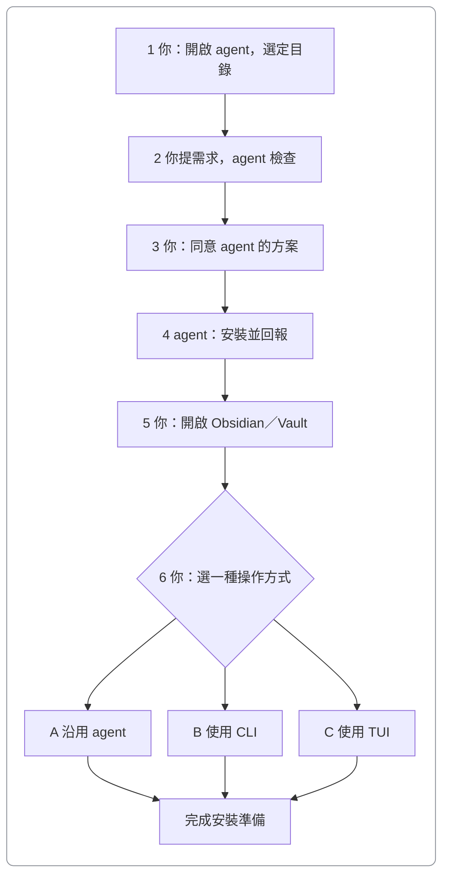

# 2. 建立可立即使用的維運環境

[全書首頁](README.md) · 上一章：[認識 OpsFeast](01-overview.md) · 下一章：[安裝驗收與目錄盤點](03-verify-installation.md)

本章帶你從準備工作目錄開始，請 agent 檢查環境、提出方案並完成安裝，再用 Obsidian 開啟教科書與維運 Vault。完成後，你會有可使用的 OpsFeast、本機管理目錄，以及閱讀結果的工具；接著在第 3 章確認安裝成果。

**這 6 個步驟由你與 agent 分工完成。**先由你開啟 agent、選好工作區並貼上安裝需求；agent 收到需求後，才開始取得 OpsFeast、檢查環境及提出方案。你確認並同意方案後，再由 agent 執行核准的安裝工作。

本文在每一步驟下方分別列出「你要做的事」、「agent 會做的事」與「完成判準」，協助你判斷該步驟是否完成。你可以依序閱讀並操作；遇到 agent 的工作時，等待它回報，再依完成判準確認結果。

如果同事已交給你裝好的 OpsFeast 或有資料的 Feast，前面的準備可能已完成。請先讓 agent [唯讀盤點既有環境](08-profiles.md#讓職務代理人或另一個-agent-接手)，沿用已有工具、設定與資料；確認現況後，從尚未完成的步驟接續。需要掛接既有管理目錄時，依 [profile 章](08-profiles.md#attach-已有管理目錄)處理，保留原有環境。

可直接複製給 agent：

```text
請先唯讀盤點我目前專案中的既有 OpsFeast 環境，找出工具 checkout、已登記 profiles、管理根目錄及可用狀態。說明安裝章哪些步驟已完成、哪些尚有缺項；先不重新安裝、不初始化、不切換預設 profile，也不連線。路徑不明時，請我補充。
```

<p class="opsfeast-figure-caption" style="margin-bottom:0 !important;padding-inline-start:8px"><strong>附圖：完成安裝與開始操作的 6 個步驟</strong></p>



新安裝依實線完成 1～6 步；已有環境則先依上方連結盤點，再從尚未完成的步驟接續。第 6 步的三條路線是擇一，選好操作方式就完成本章的安裝準備。安裝後的驗收放在第 3 章；主機連線與 recipe 採集則在後續章節進行。

## 步驟 1：開啟 AI agent，選定安裝目錄

**你要做的事：**

選擇你熟悉的 Codex、Antigravity 或其他能讀取檔案、執行指令的 AI agent，開啟一個準備用來管理 OpsFeast 的專案／工作區。第一次安裝時，可以使用新的空目錄；已有其他檔案的專案目錄也可以，下一步會讓 agent 把 OpsFeast 放在獨立子目錄中。

確認 agent 能讀取這個目錄，並能在預計安裝的電腦上執行本機指令。若 agent 在另一台電腦運作，請明確告訴它實際安裝位置與執行環境。各產品開啟工作區、取得檔案／指令權限的方式可能不同；OpsFeast 使用相同的專案文件與 CLI，不要求特定 agent 產品。

現在先選好工作區即可，不必自行 clone、建立 Python 環境或安裝 skill。下一步的需求會讓 agent 取得 OpsFeast、閱讀指引並檢查前置條件；若沒有自動發現指引，也會直接讀取 `AGENTS.md` 與 `skills/README.md`。

**agent 會做的事：**本步由你操作 AI 工具，尚未交付 OpsFeast 安裝任務。開啟工作區不等於已開始安裝；下一步貼上需求後，agent 才有明確的工作內容。

**完成判準：**你已開啟 agent 對話，知道要在哪個目錄安裝，並確認 agent 能操作該位置。

## 步驟 2：貼上安裝需求，請 agent 檢查環境

**你要做的事：**

將下列完整需求貼進步驟 1 的 agent 對話，請它開始檢查：

> 請協助我在這個專案目錄開始使用 OpsFeast。我授權從 https://github.com/iapyeh/opsfeast.git clone；目錄非空時使用 opsfeast 子目錄，保留現有檔案。若已有正確 checkout，先核對再重用，不 pull 或 reset。
>
> 閱讀實際 checkout 的 README.md、AGENTS.md、存在時的 AGENTS.local.md、skills/README.md 與 docs/getting-started.md。先檢查既有 Python、依賴與 skill，不做安裝。用繁體中文說明功能，提出你可以代為執行的具體本機方案，包括 interpreter、是否建立 venv、requirements、管理目錄與驗收方法；也請檢查 Obsidian 是否已安裝，說明閱讀工具與 Vault 樣式的準備方式，最後詢問我是否同意。取得同意前不建立環境、不安裝套件、不初始化；不要連線到任何主機。

這個 prompt 授權取得 checkout 與檢查前置條件。空工作區可以直接成為 checkout；非空工作區用 `opsfeast/` 子目錄。目的地衝突、Git 缺少或網路失敗，應先說明，不刪除檔案或自行安裝系統套件。

等待 agent 完成檢查並提出方案。這時先閱讀它的回報，再進入下一步同意安裝。需要把 skill 安裝到特定 agent 的搜尋位置時，也請它列入方案；能直接讀取隨附文件時，不必先做額外安裝。

**agent 會做的事：**依你貼上的需求取得或核對 checkout，閱讀指引，檢查 Python、依賴與 Obsidian，回報現況並提出可代辦的方案。安裝尚待步驟 3 的同意。

**完成判準：**agent 已指出實際 checkout、可用 Python、缺少的依賴，以及它能代為完成的安裝方案。

## 步驟 3：確認並同意 agent 建議的具體安裝方案

**你要做的事：**閱讀 agent 在上一步提出的方案，依下表核對位置、軟體與資料範圍，再決定是否同意。

| 項目 | 你應知道的資訊 |
| --- | --- |
| Checkout | 完整實際路徑，應能找到 `tools/opsfeast.py`、`README.md`、`skills/`、`VERSION` |
| Python | 實際 interpreter 路徑與版本，要求 Python 3.11+ |
| 環境 | 優先重用選定、正常的既有環境；新 venv 通常放 checkout 的 `.venv/` |
| 依賴 | 只做初始化用 `requirements-init.txt`；要連線與 recipe 用 `requirements.txt` |
| Obsidian | 確認是否已安裝；需要時列出官方安裝方式與要開啟的 Vault |
| TUI | 選用 `requirements-tui.txt`；需檢查 Textual 是否已在同一環境 |
| 管理目錄 | 新入門範例使用 `feasts/main/`，裡面將有 `hosts.yaml` |
| Skill | 先閱讀隨附 `skills/`；需要自動載入時，再設定所選 agent 的整合方式 |

目前完整執行要求 SSHScript 7.0.0，並核對 import、distribution、受信任來源與完整 skill 快照。不要看到更高版號就自行升級。不同 interpreter 的缺套件訊息，不能用來判定這個環境也缺套件。

Agent 會先用選定 Python 執行環境檢查；缺少依賴就提出具體安裝方案。除非有實際失敗或該 Python 發行版的正式依賴證據，不預先猜測需要 expat、編譯器等系統套件。

確認安裝位置、軟體與資料目錄都符合你的預期後，可以回覆：

> 我同意這個本機安裝方案，請依方案完成安裝與檢查，並回報實際路徑及結果。

若有項目不符合需求，先請 agent 調整方案，再同意執行。

可直接複製給 agent：

```text
我想先調整目前的安裝方案。請協助我確認哪些項目要修改，再提出更新後的安裝位置、Python 環境、依賴、閱讀工具與管理目錄方案。這次只討論方案；等我確認後，再執行尚未核准的修改。
```

**agent 會做的事：**解釋各項安裝選擇，回答你的問題，並依需求修訂方案。你同意後，依已確認的範圍進入下一步。

**完成判準：**你已同意一份具體方案，agent 清楚知道本次可以建立、安裝與初始化的範圍。

## 步驟 4：請 agent 完成安裝並回報結果

**你要做的事：**步驟 3 同意方案時，就已把安裝工作交給 agent；接著等待它執行並閱讀回報，不必再下第二次相同的授權。若它回報需要你操作的介面，依具體說明完成即可。

以下是 agent 在已有合適 `python3`、準備新建 checkout venv 並安裝完整依賴時會執行的典型指令，供你對照過程。**採用 agent 代辦時，不必再把這些指令手動執行一次。**

```sh
python3 -B -m venv .venv
.venv/bin/python -B -m pip install -r requirements.txt
.venv/bin/python -B tools/check_environment.py --json
.venv/bin/python -B tools/opsfeast.py init main --json
.venv/bin/python -B tools/opsfeast.py check --profile main --json
```

Agent 應在實際 checkout 執行上述指令；已有環境時改用選定 interpreter，不重建 venv。Init 建立並登記管理目錄、retention namespace、維運 Vault 與安裝身分；保留既有設定。新環境可能帶有示範主機，應先辨識，不能直接當成真實目標連線。

安裝只建立本機條件；連線、su/sudo、recipe 執行與排程都要有對應範圍。

閱讀 agent 的安裝回報，確認其中包含實際 checkout、Python interpreter、已安裝依賴、管理根目錄、`hosts.yaml` 位置，以及環境與設定檢查結果。若有失敗，先針對原因處理，再往下進行。

**agent 會做的事：**執行核准方案中的環境準備、依賴安裝與初始化，完成本機檢查並提供實際路徑及結果；遇到失敗時說明原因與處理方式。上方指令範例是供你理解它的工作，不是要你再重跑。

**完成判準：**agent 已完成核准的安裝工作，並提供實際位置與檢查結果，讓你知道工具及管理資料放在哪裡。

## 步驟 5：確認 Obsidian 已安裝，開啟教科書與維運 Vault

**你要做的事：**確認 Obsidian 已安裝，並開啟本書與維運 Vault。若 agent 已依核准方案完成安裝，直接開啟；需要自行安裝時，從 [Obsidian 官方下載頁](https://obsidian.md/download)取得。閱讀本書與使用 OpsFeast 隨附的維運 Vault 都需要這個工具。本書的導覽、圖表與閱讀操作以 Obsidian 為準。安裝後，選擇「將資料夾開啟為 Vault」：閱讀本書時選 `docs/textbook/zh-TW/`，查看實際維運結果時則選該 profile 管理根目錄的 `vault/`。兩者是獨立的 Vault。

Obsidian [內建 Mermaid 圖表](https://obsidian.md/help/advanced-syntax#Diagram)，可直接顯示本書流程圖及維運頁面的檔案系統使用率、介面與 IP 關係圖。切換閱讀模式即可看圖；若圖表無法顯示，先確認 Obsidian 版本與圖表語法。

**由 OpsFeast 產生的維運 Vault，樣式由 OpsFeast 自動準備。**隨附 Vault consumer 在第一次產生內容時，會將 `opsfeast-mermaid-fit.css` 放入 `.obsidian/snippets/` 並啟用；之後完整重建會更新這份受管理樣式，保留其他外觀設定與人工筆記。如果你後來自行停用它，重建也會尊重這個選擇。若 Obsidian 已開啟該 Vault，可重新開啟 Vault，讓新的讀取設定生效。

若你自行建立 Vault，或第一次將教科書資料夾開啟為新的 Vault，記得請自己的 agent 配置隨附的 [mermaid-fit.css](mermaid-fit.css)：複製到該 Vault 的 `.obsidian/snippets/` 並啟用，保留原有設定。這份樣式讓圖表隨正文寬度縮放，讓外置標題與圖框對齊、貼近，並在整張圖的前後留白。設定方式使用 [Obsidian 內建的 CSS 程式碼片段](https://obsidian.md/help/Extending%2BObsidian/CSS%2Bsnippets)。

可直接複製給 agent：

```text
請協助我為自行建立的 Vault 或教科書 Vault 配置隨附的 mermaid-fit.css。先確認這次要設定的實際 Vault 目錄；若對話中沒有路徑，請我指定。把樣式複製到該 Vault 的 .obsidian/snippets/ 並啟用，保留其他外觀設定與檔案。若已有相同設定，直接回報；遇到同名但內容不同的自訂樣式，先說明差異，不覆寫。不要重新建立 Vault 或初始化 OpsFeast。
```

Obsidian 與 Python 依賴分開安裝。你可以從官方下載頁自行安裝，或請 agent 依作業系統準備具體安裝方式後協助完成。開啟 Vault 本身不會連線或執行 recipe。

可直接複製給 agent：

```text
請檢查我要閱讀 Vault 的電腦上是否已安裝 Obsidian，並說明可用版本與開啟位置。若缺少，請根據作業系統提出官方來源的具體安裝方案；既有授權已涵蓋的工作直接完成，尚未涵蓋的安裝先列入方案。需要我操作的介面請給出具體步驟，不連線到維運主機。
```

**agent 會做的事：**依核准方案檢查或協助安裝 Obsidian，指出正確的 Vault 目錄並配置需要的樣式。若有需由你操作的安裝或開啟介面，會指出具體步驟；你依畫面確認能否閱讀。

**完成判準：**你能在 Obsidian 閱讀本書，並能開啟實際 profile 的維運 Vault、看到其首頁或主機導覽；這時尚未採集真實主機資料也屬正常。


## 步驟 6：選擇 agent、CLI 或 TUI 繼續操作

**你要做的事：**從 A／B／C 選一種適合現在需求的方式，依該段操作，完成本章的安裝準備。這三種方式是替代方案，不是要依序完成的三個子步驟；之後也可以切換。

| 方案 | 適合的情況 | 接下來做什麼 |
| --- | --- | --- |
| A：沿用 agent（推薦） | 剛開始使用，想用自然語言描述目的，讓 agent 選指令並說明結果 | 在目前對話繼續描述要做的工作 |
| B：使用 CLI | 熟悉終端，想自己選定並執行明確指令 | 開啟終端、啟用環境，查看指令說明 |
| C：使用 TUI | 偏好選單，想先瀏覽或操作已提供的互動功能 | 開啟 Home 選單；需有 Textual |

若尚不確定，先選 A 即可。TUI 的功能仍在擴充，未涵蓋的工作可改用 agent 或 CLI。

### 方案 A：沿用 agent，以自然語言提出需求

保持目前對話，後續工作繼續用自然語言交給 agent 即可。選擇這條路線時，不必另外開終端，也不必執行下方的 CLI／TUI 啟動指令。

### 方案 B：使用 CLI，啟用環境並查看指令

在實際 checkout 目錄開啟 Bash/Zsh 終端。本章使用 checkout 的 `.venv` 時，執行：

```sh
source tools/activate.sh
python -B tools/opsfeast.py --help
```

第一行讓目前終端使用已安裝的 `.venv`，只影響這個 shell。第二行列出 OpsFeast 可用指令與用途；看到 setup/profiles、hosts/access、recipes/reports、retention/consumers、Vault 等分類，就可以依工作選擇指令。這兩行不會重建環境或連線。若使用其他 Python 環境，直接呼叫選定 interpreter，不使用這個啟用腳本。

### 方案 C：使用 TUI，開啟 Home 選單

若偏好在終端用選單操作，在實際 checkout 目錄執行：

```sh
.venv/bin/python -B tools/opsfeast.py
```

這個範例直接使用本章安裝好的 `.venv`，不必先完成上一段 CLI 步驟；其他環境改用選定 interpreter。已安裝 Textual 時，指令會開啟 OpsFeast Home，供你瀏覽主機、recipe 與其他入口。開啟 Home 本身不連線；選擇主機測試或 recipe 執行才可能連線。用完可退出 Home，回到終端。

若 Textual 尚未安裝，請 agent 檢查並提出 `requirements-tui.txt` 安裝方案；也可以先沿用 agent 或 CLI，繼續後面的工作。

可直接複製給 agent：

```text
請在 OpsFeast 已選定的 Python 環境檢查 Textual 是否可 import，並回報版本。若缺少，依 requirements-tui.txt 提出具體安裝方案及影響；這次先檢查與規劃，不修改環境、不連線。
```

**agent 會做的事：**選 A 時協助選定操作與解讀結果；選 B／C 時可協助準備指令、說明選單或排除錯誤。實際由誰執行操作，依你選擇的方式與既有授權決定。

**完成判準：**你已選定操作方式；使用 agent 時知道如何繼續對話，自行操作時能看到 CLI 說明或 TUI Home。

正式參考：[初次使用流程](../../first-use.md)、[開始使用](../../getting-started.md)、[目前 TUI](../../terminal-ui.md)。

## 下一步

安裝準備完成後，前往[第 3 章：安裝驗收與目錄盤點](03-verify-installation.md)，確認環境就緒並熟悉實際產生的目錄。

*Last modified: 2026-10-26 23:35:09*
